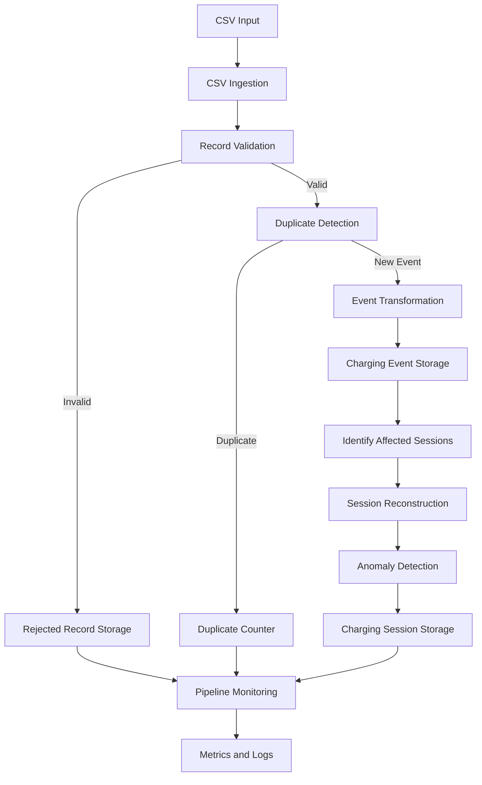

# VoltStream – System Architecture

## 1. Introduction

VoltStream is a modular, batch-oriented data processing platform designed to process EV charging events and reconstruct charging sessions.

The system follows a layered architecture in which ingestion, validation, transformation, storage, and monitoring responsibilities are separated into individual modules.

This separation makes the application easier to maintain, test, and extend.

## 2. Architectural Overview

The platform processes incoming CSV files through the following stages:

1. File ingestion
2. Record validation
3. Duplicate detection
4. Event transformation
5. Event persistence
6. Charging session reconstruction
7. Anomaly detection
8. Session persistence
9. Pipeline metrics and logging

### High-Level Architecture



## 3. Application Layers

### 3.1 Ingestion Layer

**Location:** `src/ingestion/`

Responsible for reading incoming CSV files and converting rows into structured records.

Main responsibilities:

- Reading CSV input files.
- Checking file availability and structure.
- Verifying required columns.
- Detecting duplicate or empty headers.
- Tracking source filenames and row numbers.
- Identifying malformed CSV rows.

The ingestion layer provides the raw records to the validation layer.

### 3.2 Validation Layer

**Location:** `src/validation/`

Responsible for determining whether incoming charging events satisfy the expected data requirements.

The validation process checks:

- Required fields.
- Event identifiers.
- Event types.
- Timestamp formats.
- Timezone information.
- Meter readings.
- Registered charging station identifiers.

The validation layer also supports duplicate event detection.

Invalid records are not inserted into the charging events table. Instead, they are stored in the rejected records table with their original data and rejection details.

### 3.3 Transformation Layer

**Location:** `src/transformation/`

Responsible for converting raw input records into structured event objects and reconstructing charging sessions.

It contains two major responsibilities:

**Event transformation**

- Normalizes identifiers.
- Converts event timestamps into datetime objects.
- Converts meter readings into Decimal values.
- Normalizes event types.
- Preserves source metadata.

**Session reconstruction**

Events belonging to the same session are grouped and sorted chronologically.

The reconstruction logic identifies:

- Session start time.
- Session end time.
- Initial meter reading.
- Final meter reading.
- Energy consumption.
- Session duration.
- Session status.
- Anomaly reasons.

The reconstruction logic also supports late-arriving events by ordering events using their event timestamps rather than their ingestion order.

### 3.4 Storage Layer

**Location:** `src/storage/`

Responsible for persisting processed information into PostgreSQL.

The storage layer handles:

- Charging event insertion.
- Rejected record insertion.
- Charging session creation.
- Charging session updates.

When new events affect an existing session, the session is reconstructed using its stored events and the resulting session information is persisted.

### 3.5 Monitoring Layer

**Location:** `src/monitoring/`

Responsible for monitoring pipeline execution and providing processing metrics.

It includes:

- Pipeline metrics calculation.
- Processing duration measurement.
- Acceptance, rejection and duplicate rates.
- Anomalous session counts.
- Structured application logging.
- Run-level processing reports.

### 3.6 Pipeline Orchestration

**Location:** `src/pipeline.py`

The pipeline orchestrator coordinates the complete processing workflow.

Its responsibilities include:

1. Creating pipeline run and batch tracking records.
2. Calculating the input file checksum.
3. Detecting previously processed files.
4. Reading and processing input records.
5. Updating accepted, rejected and duplicate counts.
6. Reconstructing affected charging sessions.
7. Updating batch and pipeline execution statuses.
8. Recording processing duration and logs.
9. Handling processing failures.

The orchestrator coordinates the individual modules without placing all business logic inside a single component.

## 4. Charging Session Reconstruction

A charging session consists of multiple events identified by a common session ID.

A typical session follows this sequence:

```text
START
  |
  v
METER_READING
  |
  v
STOP
```

The system groups events by session ID and sorts them using:

1. Event timestamp.
2. Event ID as a deterministic secondary ordering key.

### Session Statuses

| Status | Description |
|---|---|
| COMPLETED | A valid START and STOP sequence is available. |
| IN_PROGRESS | The session has not yet received a STOP event and has no detected anomaly. |
| ANOMALOUS | One or more session-level anomalies have been detected. |

### Energy Calculation

For a valid completed session:

```text
Energy Consumed = Final Meter Reading - Initial Meter Reading
```

Intermediate meter readings are used for consistency checks.

Session duration is calculated as:

```text
Duration = STOP Timestamp - START Timestamp
```

### Late-Arriving Events

Events may arrive in an order different from their actual occurrence timestamps.

VoltStream handles this by reconstructing affected sessions from their stored events in chronological order.

This allows a late-arriving event to be incorporated into an existing session when its event timestamp belongs earlier in the session timeline.

## 5. Data Quality and Anomaly Detection

VoltStream separates record-level validation from session-level anomaly detection.

### Record-Level Issues

These issues prevent an event from being accepted:

- Missing required fields.
- Invalid timestamps.
- Invalid event types.
- Negative meter readings.
- Unknown charging stations.

Such records are stored in `rejected_records`.

### Session-Level Anomalies

Events may individually pass validation but form an inconsistent charging session.

The reconstruction layer detects:

| Anomaly Code | Description |
|---|---|
| STATION_MISMATCH | Events within a session reference different stations. |
| MULTIPLE_START_EVENTS | More than one START event exists. |
| METER_READING_BEFORE_START | A meter reading occurs before START. |
| DECREASING_METER_READING | A meter reading decreases chronologically. |
| STOP_WITHOUT_START | A STOP event exists without a START event. |
| MULTIPLE_STOP_EVENTS | More than one STOP event exists. |
| EVENT_AFTER_STOP | An event occurs after a STOP event. |

Anomalous sessions are persisted with their anomaly reasons for traceability.

## 6. Database Architecture

VoltStream uses PostgreSQL with SQLAlchemy as its ORM.

The database contains six primary tables:

| Table | Responsibility |
|---|---|
| stations | Registered EV charging stations. |
| pipeline_runs | Pipeline execution tracking. |
| charging_events | Accepted charging events. |
| charging_sessions | Reconstructed charging sessions. |
| rejected_records | Rejected input records. |
| batch_files | Input file processing and checksum tracking. |

### Important Design Decisions

**Event-to-session relationship**

The `charging_events.session_id` field is intentionally not a foreign key to `charging_sessions`.

This allows events to be stored before a corresponding charging session has been reconstructed.

**Run-level traceability**

Pipeline run IDs connect processing activity with accepted events, rejected records, batch files, and reconstructed sessions.

**Anomaly storage**

Session anomaly reasons are stored in a PostgreSQL JSONB column, allowing multiple anomaly codes to be associated with one session.

## 7. Pipeline Execution and Traceability

Each processing execution receives a unique run ID.

Each input file receives a batch tracking record containing information such as:

- Source filename.
- File checksum.
- Processing status.
- Input count.
- Accepted count.
- Rejected count.
- Duplicate count.
- Start and completion timestamps.

The system uses these identifiers to trace processing results back to their originating input file and pipeline execution.

File-level checksum detection helps prevent repeated processing of an already processed file.

Event-level duplicate detection prevents duplicate event IDs from being inserted again.

## 8. Synthetic Data Generation

**Location:** `generators/charging_event_generator.py`

VoltStream includes a configurable synthetic data generator.

It creates datasets containing:

- Valid charging sessions.
- Invalid input records.
- Anomalous charging sessions.
- Duplicate events.

The generator uses registered stations from PostgreSQL and supports configurable record counts and random seeds.

A fixed seed allows reproducible datasets to be generated for testing and verification.

## 9. Technology Choices

| Technology | Reason for Use |
|---|---|
| Python | Core application implementation. |
| PostgreSQL | Persistent relational storage and JSONB support. |
| SQLAlchemy | Database abstraction and ORM. |
| psycopg | PostgreSQL connectivity. |
| CSV | Batch input format. |
| pytest | Automated unit and integration testing. |
| Python Logging | Application execution and error tracking. |

## 10. Testing Strategy

The project includes unit and integration tests.

Unit tests validate individual components such as:

- Record validation.
- Event transformation.
- Session reconstruction.
- Duplicate detection logic.
- Metrics calculations.
- Logging behavior.

Integration tests validate interactions involving:

- Database storage.
- Pipeline execution.
- Charging session reconstruction.
- Database relationships.
- Pipeline metrics.

The current automated test suite contains 66 passing test cases.

## 11. Current Scope

VoltStream currently implements batch-oriented CSV ingestion and processing.

The system does not currently include:

- Real-time event streaming.
- A web-based dashboard.
- A REST API.
- External EV charging station integrations.

These are outside the current implementation scope.

---

## Conclusion

VoltStream demonstrates a modular approach to processing event-based EV charging data.

By separating ingestion, validation, transformation, storage, and monitoring, the platform maintains data quality while supporting charging session reconstruction, anomaly detection, and processing traceability.

The architecture is designed to be testable, maintainable, and extensible.
