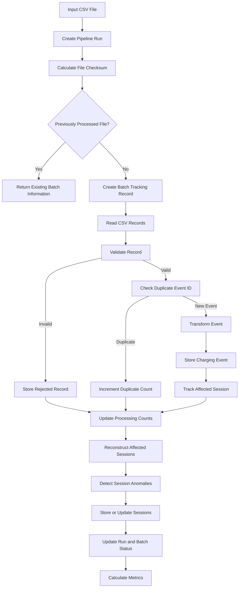

# VoltStream – Data Processing Workflow

## 1. Introduction

This document describes the end-to-end data processing workflow implemented in VoltStream.

VoltStream processes EV charging event data from CSV files through a sequence of ingestion, validation, duplicate detection, transformation, persistence, session reconstruction, anomaly detection, and monitoring operations.

The processing workflow is coordinated by the pipeline orchestrator.

## 2. End-to-End Processing Flow



## 3. Pipeline Initialization

The pipeline starts by receiving:

- A database session.
- The path to an input CSV file.

A pipeline run record is created to track the execution.

The run initially receives the `RUNNING` status.

A corresponding batch tracking record is also created with the initial `PROCESSING` status.

The system calculates a SHA-256 checksum of the input file.

This checksum is used to identify previously processed files.

If the same file has already been processed under the existing duplicate-detection rules, the pipeline returns the existing batch information rather than processing the file again.

## 4. CSV Ingestion

The ingestion module reads the input CSV file.

The expected columns are:

```text
event_id
session_id
station_id
event_type
event_timestamp
meter_kwh
```

The CSV reader performs structural checks, including:

- File existence.
- File type.
- Empty file handling.
- Header availability.
- Duplicate header detection.
- Required column verification.
- Malformed row detection.

Each row is associated with source metadata:

- Source filename.
- Source row number.
- Ingestion error information, where applicable.

This metadata is preserved for downstream processing and traceability.

## 5. Record Validation

Each incoming record is passed to the record validation module.

Validation checks include:

| Validation | Expected Condition |
|---|---|
| Event ID | Must be present |
| Session ID | Must be present |
| Station ID | Must be present |
| Event Type | START, METER_READING or STOP |
| Event Timestamp | Must be valid |
| Timezone | Timestamp must contain timezone information |
| Meter Reading | Must be numeric and non-negative |
| CSV Structure | Must not contain unexpected extra fields |

A record may generate multiple validation errors.

Each validation error contains:

- `reason_code`
- `reason_detail`

Invalid records are rejected and stored in the rejected records table.

Valid records proceed to duplicate detection.

## 6. Duplicate Event Detection

VoltStream performs event-level duplicate detection using the event identifier.

Before inserting a new event, the system checks whether the event ID already exists in the database.

If an event with the same ID exists:

- The incoming record is classified as a duplicate.
- The duplicate counter is incremented.
- The duplicate event is not inserted again.

Otherwise, the event proceeds to transformation and storage.

The pipeline also performs file-level duplicate detection using the SHA-256 checksum.

These two mechanisms operate at different levels:

| Mechanism | Identifies |
|---|---|
| File-level detection | Previously processed input files |
| Event-level detection | Previously stored event IDs |

## 7. Event Transformation

Valid, non-duplicate records are converted into structured event objects.

The transformation layer performs operations such as:

- Trimming identifiers.
- Normalizing event types.
- Parsing timestamps.
- Converting meter readings into Decimal values.
- Preserving source metadata.

The transformed event is then passed to the event storage module.

## 8. Charging Event Persistence

Accepted events are inserted into PostgreSQL.

Each event maintains information about:

- Event ID.
- Session ID.
- Station ID.
- Event type.
- Event timestamp.
- Meter reading.
- Source filename.
- Source row number.
- Associated pipeline run.
- Ingestion timestamp.

After an event is successfully stored, its session ID is added to the set of affected sessions.

This prevents unnecessary reconstruction of unrelated sessions.

## 9. Charging Session Reconstruction

After processing the input records, the pipeline reconstructs the sessions affected by newly accepted events.

For each affected session:

1. Retrieve its stored charging events.
2. Sort the events chronologically.
3. Process each event according to its type.
4. Identify the first START event.
5. Identify the first STOP event.
6. Track previous and latest meter readings.
7. Calculate energy consumption and duration when applicable.
8. Detect anomalies.
9. Determine the session status.
10. Persist the reconstructed session.

### Chronological Ordering

Events are sorted using:

```python
(
    event.event_timestamp,
    event.event_id
)
```

This provides deterministic ordering when events have identical timestamps.

### Energy Calculation

For a valid completed session:

```text
Energy Consumed = STOP Meter Reading - START Meter Reading
```

### Duration Calculation

When both START and STOP timestamps are available:

```text
Duration = STOP Timestamp - START Timestamp
```

## 10. Session-Level Anomaly Detection

VoltStream detects inconsistencies that may not be identifiable through individual record validation.

The reconstruction module checks for:

| Anomaly | Condition |
|---|---|
| STATION_MISMATCH | Events reference different stations |
| MULTIPLE_START_EVENTS | Multiple START events exist |
| METER_READING_BEFORE_START | Meter reading occurs before START |
| DECREASING_METER_READING | Meter reading decreases chronologically |
| STOP_WITHOUT_START | STOP exists without START |
| MULTIPLE_STOP_EVENTS | Multiple STOP events exist |
| EVENT_AFTER_STOP | An event occurs after STOP |

When one or more anomalies are detected, the reconstructed session receives the `ANOMALOUS` status.

The corresponding anomaly reason codes are stored in the session's JSONB column.

## 11. Rejected Record Storage

Records that fail validation are stored separately.

Each rejected record retains:

- Original source record.
- Source filename.
- Source row number.
- Rejection reason code.
- Rejection details.
- Pipeline run ID.
- Rejection timestamp.

This allows invalid data to be investigated without inserting it into the accepted charging events table.

## 12. Pipeline Metrics

Once processing and session reconstruction are complete, the pipeline stores its final processing counts.

The monitoring module calculates:

- Input count.
- Accepted count.
- Rejected count.
- Duplicate count.
- Anomalous session count.
- Processing duration.
- Acceptance rate.
- Rejection rate.
- Duplicate rate.

### Metric Formulas

**Acceptance Rate**

```text
Accepted Count / Input Count × 100
```

**Rejection Rate**

```text
Rejected Count / Input Count × 100
```

**Duplicate Rate**

```text
Duplicate Count / Input Count × 100
```

Percentages are rounded to two decimal places.

When the input count is zero, the percentage calculation returns zero.

## 13. Processing Statuses

### Pipeline Run Status

| Status | Meaning |
|---|---|
| RUNNING | Pipeline execution is in progress |
| SUCCESS | Pipeline execution completed |
| FAILED | Pipeline execution failed |

### Batch File Status

| Status | Meaning |
|---|---|
| PROCESSING | File is being processed |
| SUCCESS | File processed without rejected or duplicate records |
| PARTIAL_SUCCESS | File processed with rejected or duplicate records |
| FAILED | File processing failed |

Pipeline execution status and batch file status are separate concepts.

For example, a pipeline run may finish with `SUCCESS` while its associated batch file has `PARTIAL_SUCCESS`.

This indicates that the execution completed successfully, although some input records were rejected or identified as duplicates.

## 14. Logging and Error Handling

VoltStream uses Python's logging module to record important pipeline operations.

The logs include:

- Pipeline run creation.
- Pipeline execution start.
- CSV processing start.
- Session reconstruction.
- Processing statistics.
- Pipeline completion.
- Duplicate file detection.
- Processing exceptions.

The application writes logs to the console and its configured log file.

Errors during processing are handled through the pipeline's exception-handling logic and recorded for traceability.

## 15. Synthetic Data Processing

VoltStream provides a synthetic data generator for testing different processing scenarios.

The generator creates:

- Valid records.
- Invalid records.
- Anomalous sessions.
- Duplicate events.

The generated data can be verified and then processed using the supplied scripts.

Generate a dataset:

```powershell
python -m generators.charging_event_generator --records 300 --seed 43
```

Verify the generated CSV:

```powershell
python -m scripts.verify_generated_data
```

Process the generated dataset:

```powershell
python -m scripts.process_generated_data
```

The processing script displays the corresponding pipeline metrics.

## 16. Testing and Verification

The project includes automated unit and integration tests.

Run the test suite:

```powershell
python -m pytest -v
```

The current suite contains 66 passing test cases.

Additional verification scripts are available for:

- CSV reader verification.
- Record validator verification.
- Database relationship verification.
- Pipeline metrics verification.
- Generated dataset verification.
- Generated data processing.

## 17. Conclusion

The VoltStream processing workflow provides a structured approach to transforming raw EV charging events into reconstructed charging sessions.

It combines record-level validation, duplicate detection, event persistence, chronological session reconstruction, anomaly detection, and pipeline monitoring.

The separation of these operations helps maintain data quality, processing traceability, and maintainability throughout the system.
