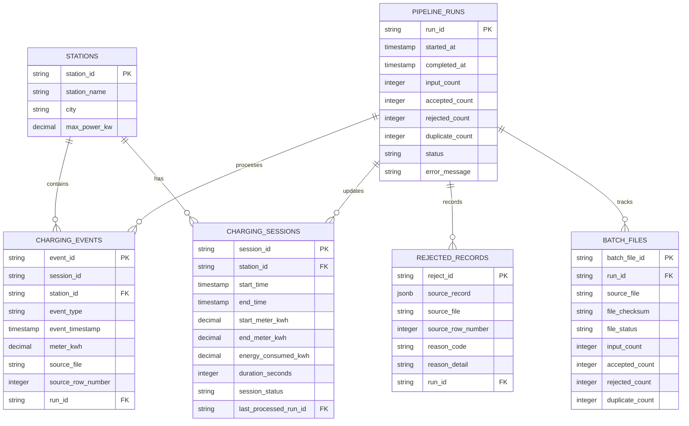

# VoltStream – Database Schema Documentation

## 1. Overview

VoltStream uses PostgreSQL as its primary persistent storage system.

SQLAlchemy is used as the Object Relational Mapper (ORM) to define database models, manage relationships, and perform database operations.

The database consists of six primary tables:

1. `stations`
2. `pipeline_runs`
3. `charging_events`
4. `charging_sessions`
5. `rejected_records`
6. `batch_files`

The schema is designed to maintain data integrity, processing traceability, and separation between accepted events, rejected records, and reconstructed charging sessions.

---

## 2. Entity Relationship Overview



**Note:** `charging_events.session_id` intentionally has no foreign key to `charging_sessions.session_id`. This supports event ingestion before session reconstruction.

---

## 3. Table Definitions

### 3.1 stations

**Purpose:** Stores registered EV charging stations.

| Column | Data Type | Constraint | Description |
|---|---|---|---|
| station_id | VARCHAR | Primary Key | Unique station identifier |
| station_name | VARCHAR | | Charging station name |
| city | VARCHAR | | City where station is located |
| max_power_kw | NUMERIC(10,2) | CHECK > 0 | Maximum charging power |

The station table provides the reference information used to validate incoming charging events.

A station can be associated with multiple charging events and charging sessions.

### 3.2 pipeline_runs

**Purpose:** Tracks individual executions of the data processing pipeline.

| Column | Description |
|---|---|
| run_id | Unique pipeline execution identifier |
| started_at | Pipeline execution start time |
| completed_at | Pipeline completion time |
| input_count | Total records received |
| accepted_count | Accepted records |
| rejected_count | Rejected records |
| duplicate_count | Duplicate records |
| status | Pipeline execution status |
| error_message | Error information when execution fails |

Supported pipeline statuses:

- `RUNNING`
- `SUCCESS`
- `FAILED`

The table also maintains non-negative count constraints.

Each execution receives a unique run ID, which is used to associate processed records and monitoring information with the corresponding pipeline execution.

### 3.3 `charging_events`

**Purpose:** Stores accepted and transformed charging events.

| Column | Description |
|---|---|
| `event_id` | Unique event identifier |
| `session_id` | Associated charging session identifier |
| `station_id` | Charging station reference |
| `event_type` | START, METER_READING or STOP |
| `event_timestamp` | Actual event occurrence timestamp |
| `meter_kwh` | Meter reading in kWh |
| `source_file` | Original CSV filename |
| `source_row_number` | Original CSV row number |
| `run_id` | Pipeline execution that accepted the event |
| `ingested_at` | Time at which the event was ingested |

**Primary key:**

- `event_id`

**Foreign keys:**

- `station_id` references `stations.station_id`.
- `run_id` references `pipeline_runs.run_id`.

**Additional database constraints:**

- `event_type` must be `START`, `METER_READING`, or `STOP`.
- `meter_kwh` must be non-negative.
- `source_row_number` must be greater than zero.

**Index:**

- `ix_charging_events_session_timestamp` on (`session_id`, `event_timestamp`).

This index supports efficient retrieval and chronological ordering of events during session reconstruction.

**Design decision:** The `session_id` column is not a foreign key because an event may arrive before its corresponding charging session is created. This allows the pipeline to ingest events independently and reconstruct sessions after processing the available events.

### 3.4 charging_sessions

**Purpose:** Stores reconstructed charging sessions.

| Column | Description |
|---|---|
| session_id | Unique charging session identifier |
| station_id | Associated charging station |
| start_time | Session start timestamp |
| end_time | Session end timestamp |
| start_meter_kwh | Initial meter reading |
| end_meter_kwh | Final meter reading |
| energy_consumed_kwh | Calculated energy consumption |
| duration_seconds | Session duration |
| session_status | Reconstructed session status |
| last_processed_run_id | Most recent pipeline run that reconstructed the session |
| anomaly_reasons | JSONB array containing detected anomaly codes |
| created_at | Record creation timestamp |
| updated_at | Last update timestamp |

Foreign keys:

- `station_id` references `stations.station_id`.
- `last_processed_run_id` references `pipeline_runs.run_id`.

Supported session statuses:

- `IN_PROGRESS`
- `COMPLETED`
- `ANOMALOUS`

The `anomaly_reasons` column uses PostgreSQL JSONB to store multiple anomaly codes for an individual session.

Example:

```json
[
  "MULTIPLE_START_EVENTS",
  "DECREASING_METER_READING"
]
```

The session record is updated when newly accepted events affect an existing session.

### 3.5 rejected_records

**Purpose:** Maintains records that fail validation.

| Column | Description |
|---|---|
| reject_id | Unique rejected record identifier |
| source_record | Original record stored as JSONB |
| source_file | Original CSV filename |
| source_row_number | Original CSV row number |
| reason_code | Machine-readable rejection reason |
| reason_detail | Explanation of the rejection |
| run_id | Associated pipeline execution |
| rejected_at | Rejection timestamp |

Foreign key:

- `run_id` references `pipeline_runs.run_id`.

Storing the original record and source metadata provides traceability and supports investigation of data-quality problems.

A single source record may generate multiple rejection entries if it violates multiple validation rules.

### 3.6 batch_files

**Purpose:** Tracks individual input files processed by VoltStream.

| Column | Description |
|---|---|
| batch_file_id | Unique batch identifier |
| run_id | Associated pipeline execution |
| source_file | Input filename |
| file_checksum | SHA-256 checksum of the input file |
| file_status | Batch processing status |
| input_count | Total input records |
| accepted_count | Accepted records |
| rejected_count | Rejected records |
| duplicate_count | Duplicate records |
| started_at | Batch processing start time |
| completed_at | Batch processing completion time |
| error_message | Processing error details |

Foreign key:

- `run_id` references `pipeline_runs.run_id`.

Supported batch statuses:

- `PROCESSING`
- `SUCCESS`
- `PARTIAL_SUCCESS`
- `FAILED`

The checksum is used for file-level duplicate detection.

---

## 4. Database Relationships

### Station Relationships

One station can have multiple events and multiple reconstructed sessions.

```text
stations
   |
   +---- charging_events
   |
   +---- charging_sessions
```

### Pipeline Run Relationships

One pipeline execution can be associated with multiple accepted events, rejected records, and batch files.

It can also be referenced by multiple reconstructed sessions through `last_processed_run_id`.

```text
pipeline_runs
   |
   +---- charging_events
   |
   +---- rejected_records
   |
   +---- batch_files
   |
   +---- charging_sessions
```

---

## 5. Data Integrity and Constraints

VoltStream uses database-level constraints to maintain data consistency.

These include:

- Primary key constraints for unique entity identification.
- Foreign key constraints for supported entity relationships.
- Non-negative constraints for pipeline and batch record counts.
- Positive charging power constraints for registered stations.
- Required fields enforced through NOT NULL constraints.
- Unique identifiers for events, sessions, stations, runs, and batches.

Application-level validation is performed before records are persisted.

---

## 6. Indexing Strategy

Indexes support common lookup and processing operations.

Important indexed fields include:

- Charging event session identifiers and timestamps.
- Charging session station identifiers.
- Pipeline run identifiers.
- Batch processing identifiers and checksums where configured.

The event session/timestamp index helps retrieve events in chronological order during session reconstruction.

---

## 7. Data Persistence Strategy

VoltStream separates data into three major categories:

### Accepted Events

Stored in `charging_events` after successful validation and duplicate checks.

### Rejected Records

Stored in `rejected_records` with original source data and rejection details.

### Reconstructed Sessions

Stored in `charging_sessions` after grouping and analyzing accepted events.

This separation preserves the original processing outcomes and makes it easier to investigate data-quality issues.

---

## 8. Traceability

Every pipeline execution has a unique `run_id`.

This identifier connects:

- Accepted charging events.
- Rejected records.
- Batch file tracking.
- Reconstructed charging sessions.

Each event and rejected record also retains its original filename and source row number.

Together, these fields make it possible to trace processing results back to their originating input data.

---

## 9. Design Considerations

### Why PostgreSQL?

PostgreSQL provides:

- Relational integrity through primary and foreign keys.
- Transaction support.
- Indexing capabilities.
- JSONB support for flexible anomaly and source-record information.
- Reliable persistent storage.

### Why JSONB?

JSONB allows VoltStream to store structured information that may contain multiple values, such as anomaly reason codes and original rejected records.

### Why Separate Pipeline and Batch Tracking?

Pipeline runs track execution-level information, while batch files track individual input-file processing information.

This separation makes execution monitoring and file-level traceability easier to manage.

---

## 10. Conclusion

The VoltStream database schema is designed around event ingestion, session reconstruction, data-quality management, and pipeline traceability.

By separating stations, events, sessions, rejected records, batch files, and pipeline executions, the database provides a structured foundation for the processing platform.
